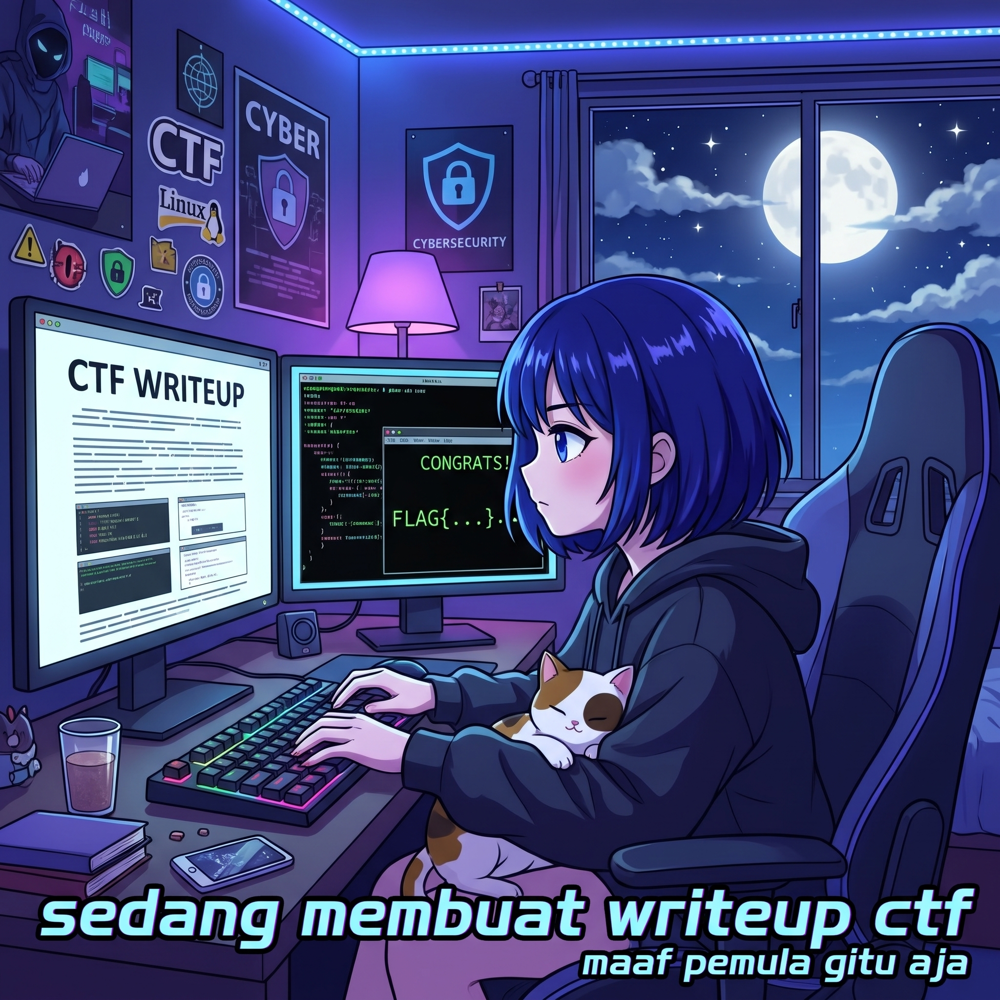

<h1 align="center">Writeup — LappungCTF Vol 3.0</h1>
<p align="center">
  <br>
  <b>Dokumentasi Writeup Resmi LappungCTF Vol 3.0</b><br>
  Oleh <b>Bagaskara Amukti Palapa</b> (<i>@BagaskaraAP-Dev</i>) · <b>Universitas Bina Darma</b>
</p>

---

## 📌 Ringkasan

Repositori ini mendokumentasikan analisis teknis dan solusi untuk tantangan kompetisi **LappungCTF Vol 3.0**, khususnya pada kategori **Web Security & Cloud / Kubernetes Security** tingkat lanjut.

Writeup ini disusun secara komprehensif, mencakup analisis kode sumber webshell, deobfuscation bitwise XOR PHP, inspeksi hak akses Kubernetes RBAC via ServiceAccount, serta eksploitasi kerentanan pembacaan berkas arbitrer pada host (*arbitrary host file read / container escape*) via symlink direktori log Kubelet.

---

## 🏆 Daftar Challenge

| # | Challenge | Kategori | Tingkat | Skor | Writeup Lengkap | Status |
|:---:|---|---|:---:|:---:|:---:|:---:|
| 1 | **Linked Shell** | Web / Cloud Security (Kubernetes Container Escape) | 🔴 Hard | **836 Poin** | [Buka Writeup →](Linked-Shell-Web/README.md) | ✅ **Solved** |

---

## 💡 Sorotan Teknis: Linked Shell (836 Poin)

> **Ringkasan Soal:** Sebuah pod Kubernetes menjalankan webshell PHP satu baris ter-obfuscate. Berkas flag berada pada mesin host di `/root/flag.txt`, bukan di dalam pod kontainer.

### Alur Eksploitasi:
1. **Deobfuscation Webshell PHP:**
   Membedah ekspresi bitwise XOR `'!~`.{' ^ '~./}/'` (`_POST`) dan `'"``~' ^ '}??!'` (`____`) untuk mengeksekusi fungsi arbitrer `$_POST['_POST']($_POST['____'])` melalui HTTP POST.
2. **Reconnaissance Hak Akses K8s:**
   Menemukan token ServiceAccount dan mengonfirmasi izin `pods/log` serta `pods/exec`, disertai mount direktori `/var/log` secara *read-write* dari host MicroK8s.
3. **Kubelet Symlink Dereference Attack:**
   Mengganti berkas log kontainer pada `/var/log/pods/...` dengan symlink yang mengarah langsung ke `/root/flag.txt` di level host.
4. **CRI Parser Failure Information Leakage:**
   Memanggil API log pod (`/api/v1/namespaces/{ns}/pods/{pod}/log`) sehingga daemon Kubelet di host membaca target symlink. Format isi flag yang bukan standar format CRI memicu error parser Kubelet yang membocorkan flag mentah:
   ```text
   failed to get parse function: unsupported log format: "LappungCTF{l1nk3d_f1l3s_1n_l0gd1r_c4n_l34k_4ny7h1n9_27f09866cf}"
   ```

---

## 🤖 Kepatuhan AI Policy (LappungCTF Vol 3.0)

Kompetisi LappungCTF Vol 3.0 menerapkan aturan ketat terkait penggunaan kakas kecerdasan buatan ([Lihat Salinan Kebijakan Resmi](lappungCTF-Vol-3.0-AI-Policy.pdf)).

Sesuai regulasi:
- Seluruh sesi konsultasi AI dicatat dan dilampirkan secara transparan.
- Sesi tanya-jawab teknis dengan DeepSeek disertakan dalam bentuk tangkapan layar asli pada direktori [`Linked-Shell-Web/images/`](Linked-Shell-Web/images/).

---

## 📂 Struktur Repositori

```text
.
├── Linked-Shell-Web/
│   ├── README.md                  # Writeup teknis langkah demi langkah
│   ├── solver.sh                  # Skrip otomatisasi exploit bash & curl
│   ├── Writeup-Linked-Shell.docx  # Berkas laporan format dokumen Word
│   └── images/
│       ├── cover.jpg              # Cover visual writeup
│       ├── logo-ubd.png           # Logo Universitas Bina Darma
│       ├── soal-webshell.png      # Tangkapan layar kode PHP webshell
│       ├── flag-terminal.png      # Bukti eksekusi solver & flag
│       ├── deepseek-01-pertanyaan.jpg # Lampiran sesi AI (pertanyaan)
│       └── deepseek-02-jawaban.jpg    # Lampiran sesi AI (jawaban)
├── lappungCTF-Vol-3.0-AI-Policy.pdf # Dokumen regulasi AI resmi kompetisi
├── .gitignore
└── README.md                      # Dokumentasi utama repositori
```

---

## 📜 Lisensi & Etika

Seluruh materi dalam repositori ini disusun untuk tujuan **edukasi, riset akademik, dan dokumentasi kompetisi keamanan siber**. Segala bentuk eksploitasi hanya dilakukan terhadap infrastruktur lab resmi yang disediakan panitia kompetisi LappungCTF.

---
*Dibuat oleh **Bagaskara Amukti Palapa** ([@BagaskaraAP-Dev](https://github.com/BagaskaraAP-Dev)) — Mahasiswa Universitas Bina Darma.*
